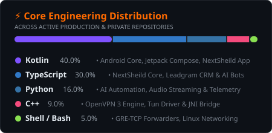

<div align="center">


<p align="center">
  <a href="#-معرفی-و-دیدگاه-مهندسی-فارسی"><b>🇮🇷 بخش فارسی</b></a> &nbsp;•&nbsp;
  <a href="#-system-architecture--engineering-hud-english"><b>🇬🇧 English Overview</b></a> &nbsp;•&nbsp;
  <a href="#-ارتباط-مستقیم--direct-transmission"><b>📡 ارتباط مستقیم</b></a>
</p>

<a href="https://github.com/armindev3027">
  
</a>

<br/>

<p align="center">
  <a href="https://t.me/Armin_85">
    
  </a>
  &nbsp;
  <a href="mailto:arminjoogha1@gmail.com">
    
  </a>
  &nbsp;
  <a href="https://github.com/armindev3027?tab=repositories">
    
  </a>
  &nbsp;
  <a href="https://github.com/armindev3027">
    
  </a>
</p>

</div>

---

<div dir="rtl">

## 🇮🇷 معرفی و دیدگاه مهندسی (فارسی)

من **آرمین** هستم؛ معمار نرم‌افزار و توسعه‌دهنده با تمرکز ویژه بر **امنیت شبکه و پروتکل‌های رمزنگاری**، **توسعه هسته کلاینت‌های اندروید**، **هوش مصنوعی و اتوماسیون داده** و رویکرد توسعه سریع **وایب‌کدینگ (Vibe Coding)**.

هدف و علاقه اصلی من، توسعه سامانه‌هایی است که در شرایط پرنوسان شبکه، بالاترین ضریب پایداری، کمترین تأخیر و امنیت بدون نشت ارائه کنند. همچنین با اتکا به مفهوم نوین **Vibe Coding**، فاصله میان ایده اولیه تا تحویل نسخه عملیاتی پروداکشن را با هم‌افزایی توان فنی انسانی و ابزارهای خط مقدم هوش مصنوعی به حداقل می‌رسانم؛ بدون آنکه کمترین ضعفی در امنیت، معماری تمیز و مقیاس‌پذیری زیرساخت ایجاد شود.

---

### 🛡️ ارکان چهارگانه تخصص من

<table dir="rtl">
<tr>
<td width="50%" valign="top">

#### 🌐 ۱. مهندسی شبکه و پروتکل‌های ضدانسداد
- **موتورهای بومی OpenVPN 3 و SoftEther:** حذف شبیه‌سازهای مصنوعی و اتصال مستقیم ترافیک به هسته نیتیو C++ با کمترین سربار پردازنده و سوییچ سریع سرورها.
- **استخر هوشمند DNS با حافظه مسیر (Path Memory):** تفکیک سلسله‌مراتبی (Google ← Cloudflare ← شکن ← مخابرات ← ۴۰۳ ← رادار ← Quad9 ← DoH) برای تضمین حل‌نام دامنه در اختلالات اینترنت.
- **ایزوله‌سازی سشن و امنیت داده:** مسدودسازی نشت IPv6/DNS، ماسک هوشمند IP در رویدادها و نگهداری اطلاعات حساس احراز هویت در حافظه رم بدون نگاشت روی دیسک.

</td>
<td width="50%" valign="top">

#### 📱 ۲. مهندسی کلاینت‌های اندروید (Android Core)
- **رابط کاربری پیشرفته Jetpack Compose:** پیاده‌سازی ۱۰۰٪ اعلانی با انیمیشن‌های ۶۰ فریم، چیدمان واکنش‌گرا و پالت‌های تاریک OLED برای کاهش چشمگیر مصرف باتری.
- **رمزنگاری سخت‌افزاری:** استفاده از `Android KeyStore` سخت‌افزاری با استاندارد AES-256 و تدابیر پیشرفته ضد مهندسی معکوس.
- **بهینه‌سازی خط لوله R8 و WebP:** فشرده‌سازی بایت‌کد و کاهش بیش از ۳۰٪ حجم بسته نصبی همراه با ارتقای سرعت لود دارایی‌های گرافیکی.

</td>
</tr>
<tr>
<td width="50%" valign="top">

#### 🤖 ۳. هوش مصنوعی، اتوماسیون و بات‌ها
- **زیرساخت‌های نامتقارن (Async) بات:** طراحی موتورهای پرسرعت تلگرام و بله با قابلیت پردازش بلادرنگ و پایداری در صف‌های سنگین.
- **پلتفرم اختصاصی Leadgram CRM:** پردازش و پاسخ‌دهی هوشمند به کامنت‌ها و هدایت آن‌ها به دایرکت (Comment-to-DM) برای اتوماسیون فروش و تعامل.
- **تلفیق مدل‌های زبانی پیشرو (LLM):** استفاده روزمره از هوش مصنوعی برای تولید، بازبینی کد و معماری خودکار تست‌ها.

</td>
<td width="50%" valign="top">

#### ⚡ ۴. دواپس و فرهنگ وایب‌کدینگ (Vibe Coding)
- **چرخه انتشار مداوم (CI/CD):** خودکارسازی بیلدها، بررسی استاتیک کد و انتشار مستقیم پکیج‌های نهایی با GitHub Actions.
- **توسعه با سرعت نور (High-Velocity Flow):** شکستن مرزهای توسعه مرسوم با حفظ تمرکز در وضعیت Flow و اجرای سریع پروتوتایپ تا نسخه نهایی.
- **سرویس‌های تاب‌آور لینوکس:** فورواردرهای GRE/TCP، کانفیگ تونل‌های ترافیکی و بهینه‌سازی پارامترهای سوکت در کرنل لینوکس.

</td>
</tr>
</table>

</div>

---

## 🇬🇧 System Architecture & Engineering HUD (English)

```bash
┌──(armin㉿nexus-core)-[~]
└─$ neofetch --discipline "Network Security • AI • DevOps • Vibe Coding"
```

```yaml
Core_Directives:
  Operator: Armin
  Mindset: "Vibe Coding: Ultra-fast iteration, AI-orchestrated execution, and zero compromise on security."
  Security_Clearance: Hardened / Zero-Trust Architecture
  Active_Status: 🟢 Architecting Resilient Systems & Shipping High-Impact Software

Disciplines:
  Network_Engineering:
    - Protocols: OpenVPN 3 Native C++, SoftEther VPN, WireGuard
    - Traffic_Steering: Smart Multi-Tier DNS Pool with Path-Memory (UDP/TCP/DoH)
    - Tunneling: GRE/TCP Forwarders, Linux Socket Tuning, Reverse Proxies
  
  Artificial_Intelligence & Automation:
    - AI_Pipelines: LLM Tooling, Autonomous Assistants, Prompt Engineering
    - Automation_Engines: Instagram Graph API CRM (Leadgram), Telegram & Bale Bots
    - Modern_Tooling: Cursor, Claude, OpenAI API, Multi-Agent Workflows
  
  DevOps & Infrastructure:
    - Continuous_Integration: GitHub Actions Automation, Automated Releases
    - Containers_&_Orchestration: Docker, Systemd Service Hardening, Linux Kernel Optimization
    - Observability: Resilient Logging, Telemetry Stripping, Network Probing
  
  Mobile_&_Client_Engineering:
    - Stack: Kotlin, Jetpack Compose, Material 3, C++ JNI
    - Security: Android KeyStore (Hardware AES-256), R8 Aggressive Obfuscation
```

---

### 🛠️ Technical Arsenal & Ecosystem

<div align="center">

| Domain | Stack & Tooling |
| :--- | :--- |
| **Network & Security** |  |
| **AI & Automation** |  |
| **DevOps & Cloud** |  |
| **Mobile Engineering** |  |

</div>

---

### 🚀 Flagship Systems & Repositories

<div align="center">

| System | Role & Architecture | Technologies | Distribution |
| :--- | :--- | :--- | :---: |
| 🛡️ **[NextSheild App](https://github.com/armindev3027/NextSheild-app)** | Hardened Android VPN client with OpenVPN 3 C++, Smart DNS pool, 257 3D flags & multi-palette launcher themes. | `Kotlin` `Compose` `C++` `R8` | **v1.7.7 Latest** |
| 🌐 **[NextSheild Core](https://github.com/armindev3027/NextSheild)** | Central management panel and orchestration backend for distributed SoftEther VPN clusters. | `TypeScript` `Node.js` `REST` | **Active** |
| ⚡ **[Leadgram](https://github.com/armindev3027/leadgram)** | Instagram automation platform, intelligent Comment-to-DM pipeline, and lead management CRM system. | `TypeScript` `Node.js` `CRM` | **Production** |
| 🤖 **[AI Shop & Assistant Bot](https://github.com/armindev3027/ai-assistant-shop-bot-telegram-bale)** | Intelligent multi-platform e-commerce and AI assistant bot running seamlessly on Telegram and Bale. | `TypeScript` `AI` `Bot API` | **Active** |
| 🎵 **[Music Is Everything](https://github.com/armindev3027/music-is-everything-bot)** | High-throughput streaming bot integrating Spotify, YouTube, SoundCloud and Suno AI music generation. | `Python` `AsyncIO` `AI Audio` | **Active** |
| 🔄 **[GRE-TCP Forwarder](https://github.com/armindev3027/GRE-TCP-FORWARDER)** | Low-level Linux network forwarding and TCP tunneling utility for distributed infrastructure. | `Shell` `Linux Net` `Sockets` | **Stable** |

</div>

---

### 📊 Live GitHub Telemetry & Architecture

<div align="center">


<br/><br/>

<table>
<tr>
<td width="42%" align="center" valign="middle">
  
</td>
<td width="58%" align="center" valign="middle">
  
</td>
</tr>
</table>

</div>

---

### 📡 ارتباط مستقیم / Direct Transmission

<div align="center">

<p align="center">
  <a href="https://t.me/Armin_85">
    
  </a>
  &nbsp;&nbsp;
  <a href="mailto:arminjoogha1@gmail.com">
    
  </a>
  &nbsp;&nbsp;
  <a href="https://github.com/armindev3027">
    
  </a>
</p>

<sub><i>«کیفیت در مهندسی نرم‌افزار، حاصل امنیت سرسختانه، سادگی و بازبینی بی‌وقفه است.»</i></sub>


</div>
